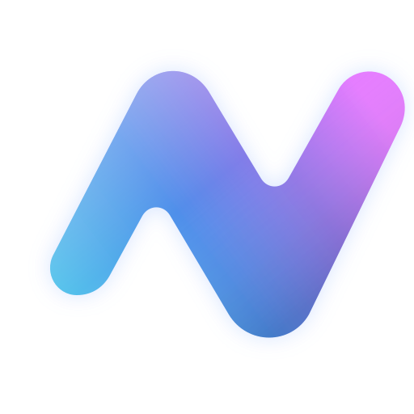

  
  
<strong>A fluid, powerful, and beautiful Linux experience.</strong>

  

    
    
    
    
    
  

# NeruOS — Nebula Edition

**NeruOS** is an early-stage, community-oriented Linux operating system project built around Arch Linux. Its first edition, **Nebula**, explores a distinctive desktop experience inspired by deep-space colors, soft light, and calm, purposeful interaction.

The long-term direction is a **standalone NeruOS desktop shell**, not a KDE Plasma theme. The current work is a Qt Quick/QML shell prototype that runs as a normal maximized application on top of an existing Linux desktop session. It does not yet replace the window manager, compositor, login session, or desktop environment.

> **Current status:** standalone shell prototype v0.2. NeruOS is not yet a bootable distribution, does not provide an installation ISO, and should not be installed as a daily-driver operating system.

## Nebula design direction

- **Appearance:** dark by default.
- **Dock:** floating, horizontally centered near the bottom, with pointer-driven magnification.
- **NeruBar:** dynamic application menus and system status area.
- **Wallpaper:** user-selectable; Nebula artwork is the default concept.
- **Navigation rail:** hidden by default and revealed from the left screen edge.
- **Visual language:** atmospheric, minimal, premium, and readable — not a macOS clone.
- **Accent colors:** Nebula Cyan and Nebula Violet, with Aurora Pink used sparingly.

See the [Nebula Design System](docs/DESIGN-SYSTEM.md) and [Branding Guide](docs/BRANDING.md).

## Current v0.2 prototype

| Component | v0.2 status |
|---|---|
| **NeruBar** | Dynamic menus change with the active demo app; status controls open NeruCenter / NeruSearch |
| **NeruDock** | Floating dock with pointer-driven icon magnification, tooltips, and active-app indicator |
| **NeruCenter** | Interactive UI values for Wi-Fi, Bluetooth, brightness, and volume; hardware APIs are not connected |
| **NeruSearch** | App suggestions and keyboard shortcut |
| **NeruSpace** | General, Coding, Gaming, and Study presets |
| **Navigation Rail** | Hidden by default; revealed from the left edge |
| **Wallpaper** | User can choose an image for the current prototype session |

These features are prototype-level UI interactions. They do not yet manage native Linux windows, launch every app, or control hardware services.

## Standalone shell strategy

The project is organized around its own shell components:

- **NeruBar** — dynamic app menu, clock, status area, and quick actions.
- **NeruDock** — app launcher, active-app indicators, and magnification.
- **NeruCenter** — quick settings and notifications.
- **NeruSearch** — universal app and settings launcher.
- **NeruSpace** — workspace identity and switching.
- **NeruFiles / NeruStore / NeruSettings** — planned first-party applications.

A standalone shell still needs a Linux graphics session and a window manager / compositor. The current prototype uses the one already running on the host machine. Replacing that foundation requires a separate engineering milestone.

## Technology direction

| Area | Direction |
|---|---|
| Base system | Arch Linux |
| Shell UI | Qt 6 and QML |
| Current window / compositor host | Existing Linux desktop session (for safe development and testing) |
| Long-term desktop session | Standalone NeruOS shell integration; compositor/window-management choice still to be decided |
| Package management | pacman |
| System image | archiso, after the shell and recovery strategy are stable |
| Graphics | Wayland-first direction; hardware support must be tested |
| Gaming | Steam, Proton, Vulkan, Gamescope where supported |
| Windows software | Native ports or compatibility layers where practical; Windows VM for selected productivity apps |
| Strict Windows anti-cheat games | A supported native Windows installation may still be required |

### Windows compatibility and anti-cheat

NeruOS will aim for useful Windows application compatibility, but it cannot promise that every EXE or every game will run on Linux. Compatibility depends on APIs, vendor support, drivers, and anti-cheat policy.

Some kernel-level anti-cheat systems require a Windows kernel and may reject virtual machines. Games such as Valorant should therefore be treated as requiring a supported native Windows environment unless their publisher changes its platform policy. NeruOS will not attempt to bypass or impersonate anti-cheat security checks.

## Try the current UI prototype

The **qt-desktop/** directory contains a standalone Qt Quick/QML shell prototype. It is designed to be tested on an existing Arch Linux or CachyOS session without replacing the current desktop shell or changing boot configuration.

### Build requirements

- Arch Linux or CachyOS
- CMake, Ninja, and a C++17 compiler
- Qt 6.5 or newer: Qt Quick, Qt Quick Controls 2, and Qt SVG

Install packages:

~~~bash
sudo pacman -S --needed base-devel cmake ninja qt6-base qt6-declarative qt6-svg
~~~

Build and run:

~~~bash
git clone https://github.com/Nael12-kobo/NeruOS.git
cd NeruOS/qt-desktop
cmake -S . -B build -G Ninja
cmake --build build
./build/neruos-nebula
~~~

Or use the helper script:

~~~bash
chmod +x build.sh
./build.sh
~~~

The prototype is a normal maximized application window. Close it like any other application. It does not install a shell, change your Plasma / GNOME configuration, or modify your bootloader.

See [Prototype Installation](docs/INSTALLATION.md).

## Repository map

~~~text
NeruOS/
├── assets/                 # Logo and brand assets
├── docs/                   # Project, design, architecture, and install docs
├── qt-desktop/
│   ├── Main.qml            # Shell composition and prototype state
│   ├── NeruBar.qml         # Dynamic application menu and status bar
│   ├── NeruDock.qml        # Floating magnifying dock
│   └── assets/             # Nebula wallpaper and logo resources
├── .github/                # Issue and pull request templates
├── CHANGELOG.md
├── CODE_OF_CONDUCT.md
├── CONTRIBUTING.md
├── LICENSE
├── README.md
└── SECURITY.md
~~~

## Roadmap

1. **Shell prototype** — standalone QML components, dynamic NeruBar, magnifying NeruDock, and keyboard interaction.
2. **Native app integration** — reliable application discovery, launching, focus, and window state.
3. **System services** — real NeruCenter controls, notifications, and session integration.
4. **Desktop session engineering** — compositor / window-manager strategy, login session, crash recovery, and multi-monitor behavior.
5. **First-party utilities** — NeruSettings, NeruSearch, NeruFiles, and NeruStore.
6. **System image** — reproducible Arch-based image, installer, updates, rollback, and recovery.
7. **Alpha ISO** — only after installation, recovery, and upgrade paths are tested.

Read the [full roadmap](docs/ROADMAP.md). Planned features are not released features.

## Contributing

Issues, documentation improvements, design feedback, and code contributions are welcome. Please read [CONTRIBUTING.md](CONTRIBUTING.md) before opening a pull request.

## License

Original NeruOS project code and documentation are provided under the [MIT License](LICENSE), unless a file states otherwise. Third-party assets and dependencies retain their own licenses.

  
  
<strong>NeruOS — Find your flow.</strong> Built in the open. Powered by curiosity.

