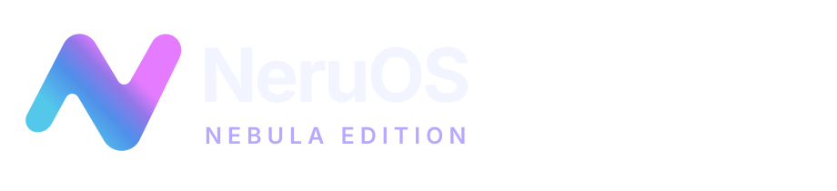

  
  
<strong>A fluid, powerful, and beautiful Linux experience.</strong>

  

    
    
    
    
    
  

# NeruOS — Nebula Edition

**NeruOS** is an early-stage, community-oriented Linux operating system project built around Arch Linux. Its first edition, **Nebula**, explores a distinctive desktop experience inspired by deep-space colors, soft light, and calm, purposeful interaction.

The long-term direction is a **standalone NeruOS desktop shell**, not a KDE Plasma theme. The VM Alpha image now starts its own Wayland session with labwc and launches the native Qt 6 / C++ / QML Nebula shell. labwc manages native windows and virtual desktops; NeruOS provides the desktop UI, dock, quick settings, notifications, app search, file manager, settings, and session panel.

> **Current status:** v0.4.0-alpha1 is a diskless x86_64 live ISO with UEFI (themed GRUB) and Legacy BIOS (Syslinux) boot paths. The latest image has booted through UEFI in QEMU and reached the full Nebula desktop. The Legacy BIOS path is included, but the current SeaBIOS/QEMU test did not reach the desktop and remains unverified. No installer is included, and the VM helpers do not attach host disks. NeruOS remains an early VM-only prototype and is not ready for installation on physical hardware.

## Nebula design direction

- **Appearance:** dark by default.
- **Dock:** floating, horizontally centered near the bottom, with pointer-driven magnification.
- **NeruBar:** dynamic application menus and system status area.
- **Wallpaper:** user-selectable; Nebula artwork is the default concept.
- **Navigation rail:** hidden by default and revealed from the left screen edge.
- **Visual language:** atmospheric, minimal, premium, and readable — not a macOS clone.
- **Accent colors:** Nebula Cyan and Nebula Violet, with Aurora Pink used sparingly.

See the [Nebula Design System](docs/DESIGN-SYSTEM.md) and [Branding Guide](docs/BRANDING.md).

## Current v0.4.0-alpha1 development

| Component | v0.4.0-alpha1 status |
|---|---|
| **NeruBar** | Native menu bar, workspace label, clock, system status, and actions |
| **Window management** | labwc manages native windows, focus, minimize/maximize, snap, close, and window switching |
| **NeruDock** | Individual PNG app icons, hover magnification, launch aliases, and running indicators |
| **NeruSearch** | Discovers and launches installed Linux desktop applications through GIO |
| **NeruCenter** | NetworkManager Wi-Fi, PipeWire/WirePlumber audio, BlueZ Bluetooth, brightness, and battery status where hardware is available |
| **Notification Center** | Receives freedesktop notifications through the session D-Bus and keeps recent session history |
| **NeruSpace** | Four real labwc virtual desktops: General, Coding, Gaming, and Study |
| **NeruFiles** | Native file manager with navigation, file operations, trash, and hidden-file visibility |
| **NeruSettings** | Saved wallpaper, accent, appearance preference, and dock pin configuration |
| **Session Panel** | systemd-logind power/session actions and PAM-backed swaylock; Regreet is packaged for a future persistent install |
| **VM Alpha** | x86_64 live ISO with themed UEFI GRUB, Legacy BIOS Syslinux, and diskless QEMU test paths |

**Process status is a best-effort indicator, not a window manager's active-window state.** Apps that launch through helper processes, D-Bus activation, sandboxes, or wrappers may not match the desktop entry executable. Multiple entries using the same executable may share a process status.

## Standalone shell strategy

The project is organized around its own shell components:

- **NeruBar** — native menu bar, clock, status area, and quick actions.
- **NeruDock** — individually configurable PNG launchers, magnification, and running indicators.
- **NeruCenter** — hardware-backed quick settings where services and devices are available.
- **NeruSearch** — installed Linux app discovery and launch through GIO.
- **NeruSpace** — four virtual desktops managed by labwc.
- **NeruFiles / NeruSettings** — first-party Qt Quick windows for files and desktop preferences.
- **Notification Center / Session Panel** — desktop notifications and system session actions.

The VM Alpha session uses labwc as its Wayland compositor/window manager. NeruOS remains the shell and desktop UI; it does not implement a compositor of its own.

## Technology direction

| Area | Direction |
|---|---|
| Base system | Arch Linux |
| Shell UI | Qt 6 and QML |
| Application discovery / launch | GIO GAppInfo / desktop entries |
| Current window / compositor | labwc in the dedicated NeruOS Wayland VM session |
| Desktop session | Native Qt 6 / C++ / QML shell launched by labwc |
| Package management | pacman |
| VM system image | ArchISO-based x86_64 live image for diskless testing |
| Graphics | Wayland-first direction; hardware support must be tested |
| Gaming | Steam, Proton, Vulkan, Gamescope where supported |
| Windows software | Native ports or compatibility layers where practical; Windows VM for selected productivity apps |
| Strict Windows anti-cheat games | A supported native Windows installation may still be required |

### Windows compatibility and anti-cheat

NeruOS will aim for useful Windows application compatibility, but it cannot promise that every EXE or every game will run on Linux. Compatibility depends on APIs, vendor support, drivers, and anti-cheat policy.

Some kernel-level anti-cheat systems require a Windows kernel and may reject virtual machines. Games such as Valorant should therefore be treated as requiring a supported native Windows environment unless their publisher changes its platform policy. NeruOS will not attempt to bypass or impersonate anti-cheat security checks.

## Try the current UI prototype

The **qt-desktop/** directory contains a standalone Qt Quick/QML shell prototype. It is designed to be tested on an existing Arch Linux or CachyOS session without replacing the current desktop shell or changing boot configuration.

### Build requirements

- Arch Linux or CachyOS
- CMake, Ninja, and a C++17 compiler
- Qt 6.5 or newer: Qt Quick, Qt Quick Controls 2, and Qt SVG
- GLib / GIO 2.0 development files

Install packages:

~~~bash
sudo pacman -S --needed base-devel cmake ninja qt6-base qt6-declarative qt6-svg glib2
~~~

Build and run:

~~~bash
git clone https://github.com/Nael12-kobo/NeruOS.git
cd NeruOS/qt-desktop
cmake -S . -B build -G Ninja
cmake --build build
./build/neruos-nebula
~~~

List discovered applications from the terminal:

~~~bash
./build/neruos-nebula --list-apps
~~~

To launch a known desktop entry and run a short process-detection check:

~~~bash
./build/neruos-nebula --launch-app org.kde.dolphin.desktop
~~~

The prototype is a normal maximized application window. Close it like any other application. It does not install a shell, change your Plasma / GNOME configuration, or modify your bootloader.

See [Prototype Installation](docs/INSTALLATION.md), [Application Discovery and Launch](docs/APPLICATION-LAUNCHING.md), [Desktop Shell Architecture](docs/DESKTOP-SHELL.md), [VM Alpha Safety and Testing](docs/VM-ALPHA.md), and [Update Strategy](docs/UPDATE-STRATEGY.md).

## Repository map

~~~text
NeruOS/
├── assets/                 # Logo and brand assets
├── docs/                   # Project, design, architecture, VM, and update docs
├── iso/profile/            # UEFI GRUB + Legacy BIOS Syslinux live ISO profile
├── scripts/                # Rootless ISO build and diskless VM launch helpers
├── qt-desktop/
│   ├── AppCatalog.h/.cpp   # GIO app discovery, launch, process status
│   ├── Main.qml            # Shell composition
│   ├── NeruBar.qml         # Dynamic menu and status bar
│   └── NeruDock.qml        # Floating magnifying dock
├── .github/                # Issue and pull request templates
├── CHANGELOG.md
├── CONTRIBUTING.md
├── LICENSE
├── README.md
└── SECURITY.md
~~~

## Roadmap

1. **Shell prototype** — standalone QML components, dynamic NeruBar, magnifying NeruDock, and keyboard interaction.
2. **Application discovery and launch** — read desktop entries, launch through GIO, and show best-effort process status.
3. **Native window integration** — reliable application/window state, focus, minimize, and close via a chosen session architecture.
4. **System services** — real NeruCenter controls, notifications, and session integration.
5. **Desktop session engineering** — compositor/window-manager strategy, login session, crash recovery, and multi-monitor behavior.
6. **First-party utilities** — NeruSettings, NeruFiles, and NeruStore.
7. **VM Alpha ISO** — build a live image with themed UEFI GRUB and Legacy BIOS Syslinux, no installer, and no writable host-disk access; validate both paths in QEMU / VirtualBox.
8. **Persistent system engineering** — installer, signed NeruOS package repository, project release feed, upgrade, rollback, and recovery.
9. **Hardware Alpha** — only after VM installation, update, and recovery paths are tested.

Read the [full roadmap](docs/ROADMAP.md). Planned features are not released features.

## Contributing

Issues, documentation improvements, design feedback, and code contributions are welcome. Please read [CONTRIBUTING.md](CONTRIBUTING.md) before opening a pull request.

## License

Original NeruOS project code and documentation are provided under the [MIT License](LICENSE), unless a file states otherwise. Third-party assets and dependencies retain their own licenses.

  
  
<strong>NeruOS — Find your flow.</strong> Built in the open. Powered by curiosity.

## Boot menu branding

The x86_64 live ISO uses a native GRUB theme for UEFI and a matching
Syslinux compatibility menu for Legacy BIOS. The UEFI theme is intentionally
minimal: deep navy background, subtle blue-violet waves, separate NeruOS logo,
a restrained glass panel, and a soft selected-entry highlight.

Theme sources are kept separate under `iso/profile/grub/theme/`; the GRUB
menu and recovery entries are in `iso/profile/grub/grub.cfg`. Legacy BIOS
assets and configuration are in `iso/profile/syslinux/`.

Build with `./scripts/build-vm-iso.sh`. Test UEFI with
`./scripts/run-vm-alpha.sh` and Legacy BIOS with
`./scripts/run-vm-alpha-bios.sh`. Both VM helpers are diskless and do not
attach host disks.
